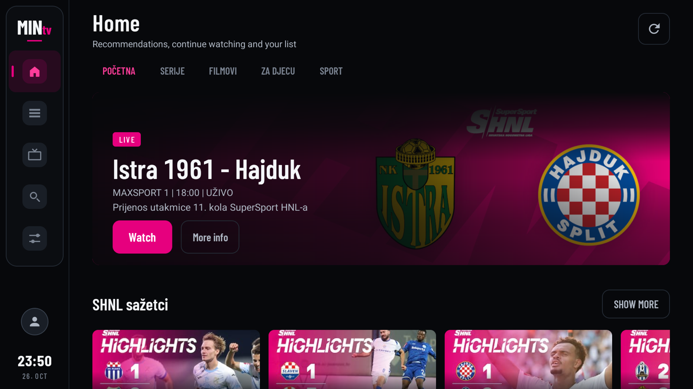
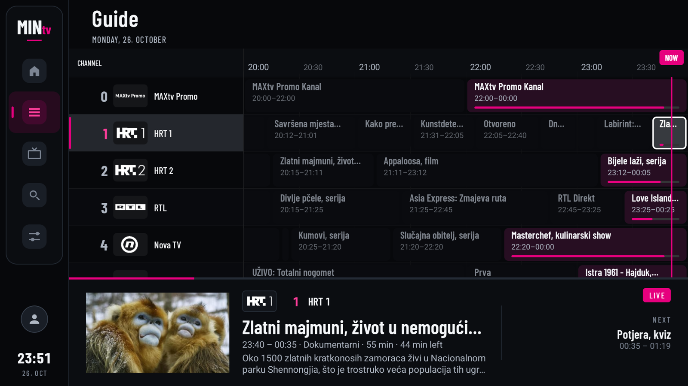
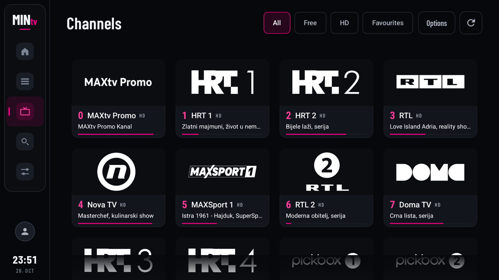
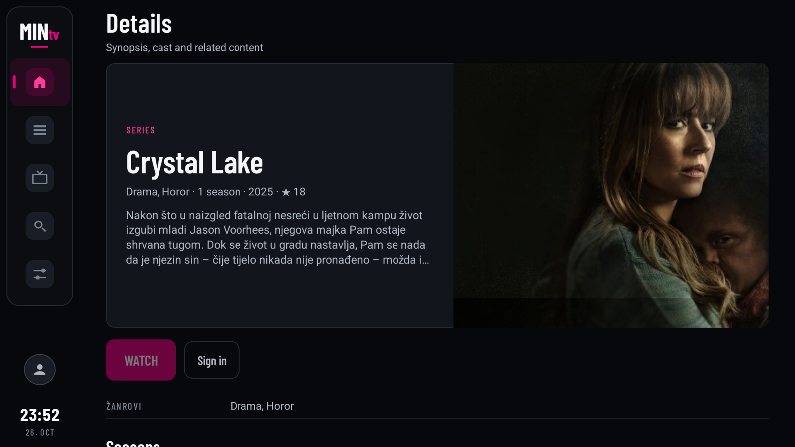
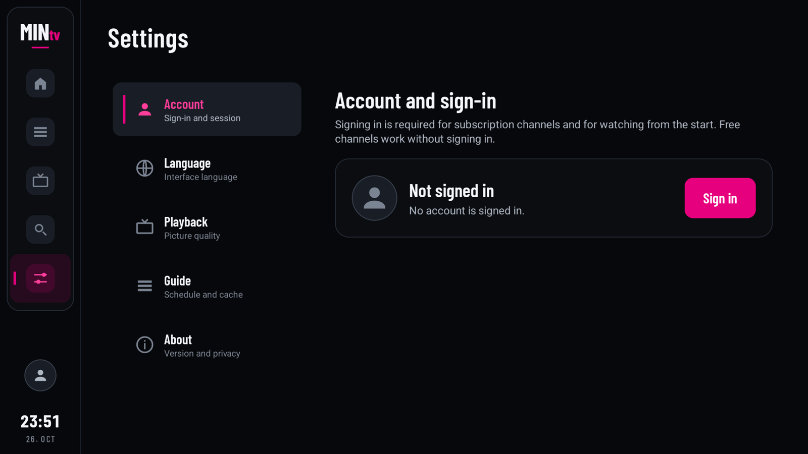
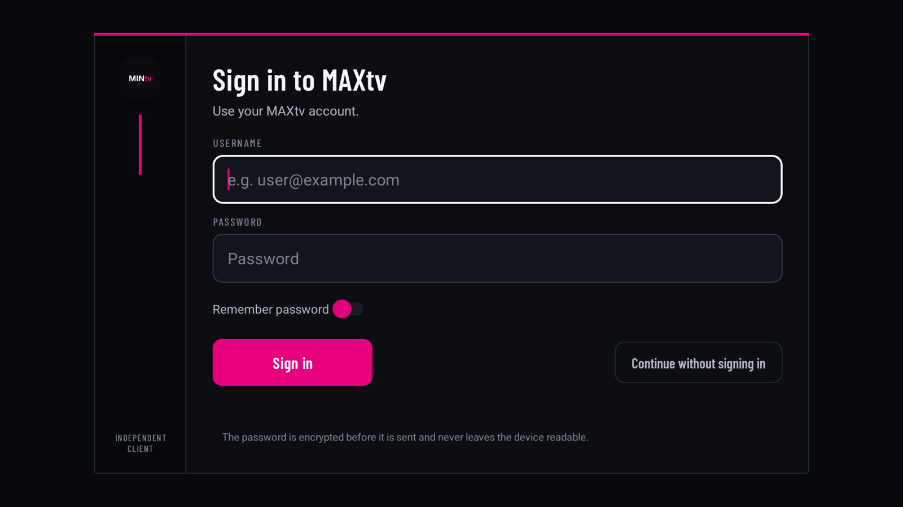
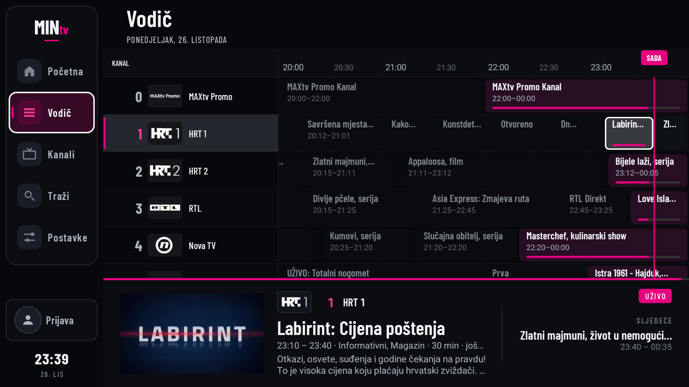

# MINtv

A small, fast Android TV client for **MAXtv** (Hrvatski Telekom), built for a single
household's own subscription. No analytics, no ads, no Firebase, no telemetry — just the
channels, the guide, the catalogue and the player.



> Unofficial and unaffiliated with Hrvatski Telekom. It talks to the same public service the
> official web player uses, with your own account. You need a valid MAXtv subscription.
> DRM is never circumvented: licences are requested from the official server with the
> signed-in user's own session.

## About the service

MAXtv is not a bespoke Hrvatski Telekom product. The app and the streaming stack behind it are
a re-licensed build of a white-label TV platform: the supplier sells the same client, BFF,
guide, entitlements and player to a number of other operators, who re-brand it and plug in
their own channels and content deals. Only the branding and the catalogue differ — the
behaviour and the API shape are the same everywhere.

The shared origins are visible in the endpoints this repo talks to:

- `tv-hr-prod.yo-digital.com/hr-bifrost` — the BFF (home rails, search, details, EPG)
- `gateway-hr-proxy.tv.yo-digital.com/hr-idm` — sign-in and session
- `widevine.entitlement.theplatform.eu` — Widevine licences, via Comcast's `theplatform`

MINtv is an independent client for that same public service, not a copy of HT's app.

## Screens

| Guide (EPG) | Channels |
| --- | --- |
|  |  |
| **Details** | **Settings** |
|  |  |

| Sign in | Rail on focus |
| --- | --- |
|  |  |

<sub>Screenshots are 1080p captures from an Android TV emulator, with the interface in English
and the MAXtv catalogue text left in Croatian, as the service returns it.</sub>

## What works

### Browsing

- **Home rails** — the server-driven MAXtv home page: hero highlights, editorial rails
  (series, films, kids, sport), continue watching, your list, favourite channels and on-now,
  with "show more" grids behind each rail.
- **Search** — films, series, people and channels, split across filters, with a local
  recent-search history and the same detail cards as the rest of the app.
- **Watchlist / Continue Watching** — add from details, resume a catch-up item, and remove
  with TV-style multi-select.
- **Content details** — programme and series metadata, actions, seasons and episodes, cast
  and related content, all reachable from the rails, search and the guide.
- **Guide (EPG)** — a TiviMate-style grid: 247 channels, a full day of programmes, day ruler,
  now line, progress on the current show, and channel logos.
- **Channels** — favourites, a free-to-air filter, HD filter, custom channel order and a reset
  to the broadcast order.
- **Hrvatski / English UI** — choose the app language in Settings; the catalogue text stays as
  the service returns it.

### Watching

- **Live TV** — DASH playback with Widevine for subscription channels, clear DASH for the
  free-to-air ones.
- **Channel zapping** — `CH+`/`CH-` or `UP`/`DOWN` straight from the picture, with a compact
  channel switcher when the overlay is open.
- **Catch-up / time shift** — pick a programme that already aired in the guide and it plays
  from the beginning.
- **Resume and progress** — VOD/catch-up progress is written to the account every five
  seconds, flushed on pause/stop, and resumed from the last position.
- **Quality control** — `Auto` (fast start, then highest), `Max` (1080p from the first frame,
  no switching) or `720p` (data saver), applied immediately. The player always shows the
  **actual** resolution being produced (e.g. `1080p` or `720p`), not the preference.
- **Player settings** — quality, subtitles and audio language live in one sheet; the channel
  switcher stays a clean channel list.
- **Fast start** — first frame in about a second on a healthy link, plus a watchdog that
  re-resolves the CDN token when it lands on a slow edge.

## Remote

| Surface | Key | Action |
| --- | --- | --- |
| Picture | `OK` | Open the channel switcher |
| Picture | `UP` / `DOWN`, `CH+` / `CH-` | Zap to the next / previous channel |
| Picture | `LEFT` / `RIGHT` | Seek −10 s / +10 s |
| Overlay | `OK` | Play / pause |
| Overlay | `DOWN` | Playback settings (quality, subtitles, audio) |
| Overlay | `UP`, `CH+` / `CH-` | Zap without leaving the overlay |
| Overlay | `BACK` | Hide the overlay (a second `BACK` exits the player) |
| Guide | `OK` | Watch live, or watch from the start if the programme has already begun |
| Guide | `LEFT` / `UP` at the first cell | Move focus to the rail |
| Rail | `UP` / `DOWN` | Move between destinations; the rail widens while focused |
| Rail | `RIGHT` | Back into the content column |

## Build

Requires JDK 17+ and the Android SDK (compileSdk 34). No NDK.

```bash
./gradlew assembleRelease
```

The release build is R8-minified and signed with the local debug key, which is fine for
sideloading but not for distribution. Point `signingConfigs` at your own keystore if you
want a proper release key.

Install on a TV over ADB:

```bash
adb install -r app/build/outputs/apk/release/app-release.apk
```

For day-to-day work, `./gradlew assembleDebug` and `adb install -r app/build/outputs/apk/debug/app-debug.apk`.

## Requirements

- Android TV / Google TV, Android 8.0 (API 26) or newer.
- Widevine is required for subscription channels (the TV must have it; virtually all do).
- **MAXtv does not work over a VPN.** The CDN rejects VPN egress; turn it off while watching.

## Docs

- [`DESIGN.md`](DESIGN.md) — the visual system: typography, spacing, focus and state rules.
- [`PRODUCT.md`](PRODUCT.md) — scope, surfaces and the decisions behind them.

## Notes

- The app is `local.mintv` on device. Rename the application id before publishing
  anywhere.
- Keys and constants that are published by the service's own web client are bundled so the
  app can talk to it; no private keys of ours are involved.
- The interface is built on framework views only (plus RecyclerView, OkHttp and Media3), which
  keeps the APK small and cold start quick.

## License

Private project, no license granted.
